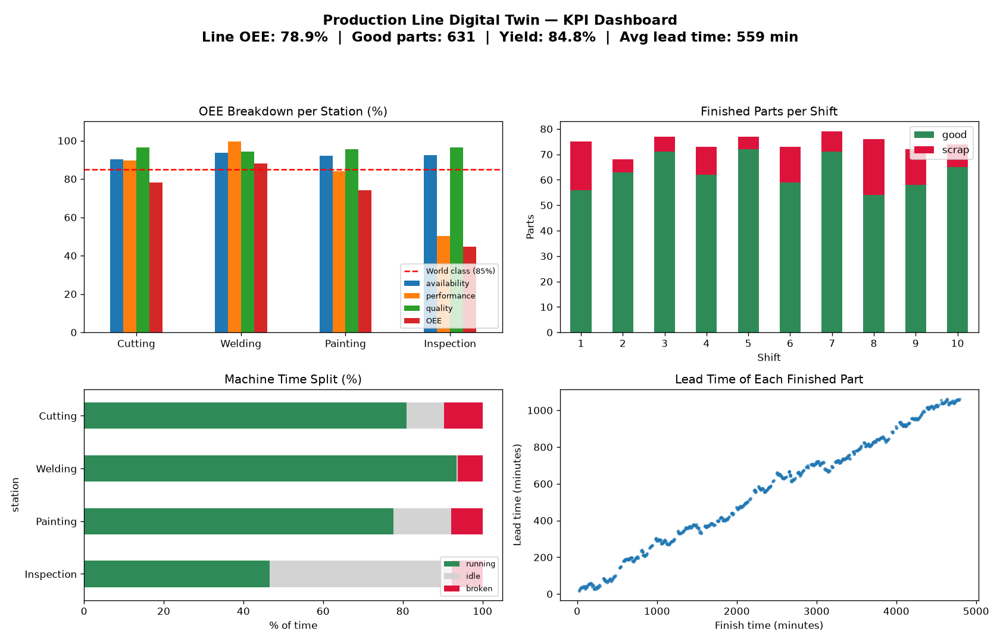
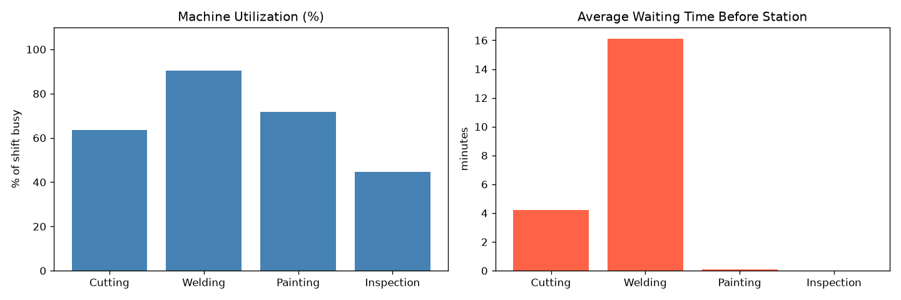
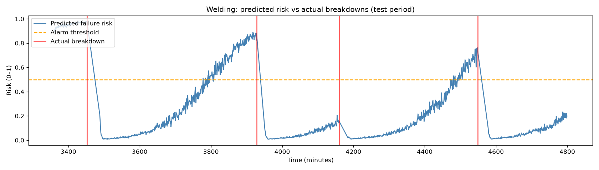

# 🏭 Production Line Digital Twin

A digital twin of a 4-station production line (**Cutting → Welding → Painting → Inspection**), built in Python with discrete-event simulation.

The twin simulates parts flowing through the line, machines wearing out and breaking down, and sensors reporting temperature and vibration. On top of that it calculates factory KPIs, tests improvement ideas before any money is spent, and trains a machine-learning model that warns about breakdowns before they happen.



## What's inside

| Notebook | What it does | Output |
|---|---|---|
| [01 Simulation](notebooks/01_production_line_simulation.ipynb) | Simulates one 8-hour shift and finds the bottleneck | `simulation_log.csv` |
| [02 Sensors & breakdowns](notebooks/02_sensor_data.ipynb) | Adds machine health, wear, breakdowns, defects and per-minute sensors over 10 shifts | `production_log.csv`, `sensor_log.csv`, `failure_log.csv` |
| [03 KPI dashboard](notebooks/03_kpi_dashboard.ipynb) | Calculates OEE, yield, throughput, lead time, WIP, MTBF and MTTR | `kpi_per_station.csv`, dashboard |
| [04 What-if scenarios](notebooks/04_what_if_scenarios.ipynb) | Compares 6 improvement scenarios, finds the best maintenance threshold, builds a simple business case | scenario charts |
| [05 Predictive maintenance](notebooks/05_predictive_maintenance.ipynb) | Predicts a breakdown within the next 30 minutes from sensor data | `failure_predictor.joblib` |

Each notebook explains its steps and formulas in markdown before every code cell.

## Key results

**The bottleneck is Welding.** It takes 6 min per part while a new part arrives every 5 min on average. It runs at about 90% utilization, and parts queue for 16 min in front of it.



**Line KPIs over 10 shifts:**

| KPI | Value |
|---|---|
| Line OEE | 78.9% (world class is 85%) |
| Good parts | 631 of 744 finished |
| Yield | 84.8% |
| Throughput | 74.4 parts per shift |
| Average lead time | 559 min |

**What-if scenarios** (average of 5 runs each):

| Scenario | Good parts/shift | vs baseline | Net gain/shift* |
|---|---|---|---|
| Baseline | 67.2 | — | — |
| Second welder | 78.4 | +16.6% | $74 |
| Faster welder (4.5 min) | 78.8 | +17.3% | $132 |
| Preventive maintenance at 60% health | 72.6 | +8.0% | $68 |
| Faster repairs | 70.1 | +4.3% | −$62 |
| **Second welder + preventive maintenance** | **85.4** | **+27.0%** | **$174** |

\*Using example costs and $20 profit per good part.

Doing preventive maintenance when health drops below **60%** gives the most output. With a lower threshold, machines break first. With a higher one, they stop too often.


**Predictive maintenance:**
- Logistic regression (ROC AUC 0.78) slightly beat a random forest.
- It caught **13 of 16 breakdowns (81%)** in the test period, on average **28 minutes** in advance.



## How it works

- **Simulation:** [SimPy](https://simpy.readthedocs.io/) models each station as a resource with a queue. Parts arrive at random (exponential gaps), and processing times vary ±20%.
- **Wear and failures:**
  - Each part lowers a machine's health by about 1 point.
  - The chances of a breakdown and of a defect rise as health drops.
  - A repair takes 20–40 min and restores health to 100.
- **Sensors:** temperature and vibration rise with wear, plus Gaussian noise, and are read every minute.
- **ML:** each reading is labelled "fails soon" if the station breaks within 30 min. Features are the current sensor values, 10-reading rolling averages and the station. The train/test split is by time: train on the first 70%, test on the last 30%.

## Getting started

```bash
pip install -r requirements.txt
```

```bash
pip install jupyter
```

Then run the notebooks **in order**: 03 and 05 read the CSVs that 02 creates. Every run uses fixed random seeds, so results are reproducible.

```
├── notebooks/   the 5 notebooks
├── data/        generated CSV logs and KPIs
├── images/      charts saved by the notebooks
├── models/      trained failure predictor
└── requirements.txt
```

## Limitations

- All data is simulated. Machine behaviour, costs and probabilities are illustrative, not taken from a real factory.
- The predictor raises a lot of false alarms: about 449 alarm-minutes per shift, with a precision of about 19%. It works as an early-warning signal that tells you to check a machine, not as a definite failure call.
- Notebook 04 uses different failure and defect formulas than notebook 02, so their baseline numbers differ slightly.
